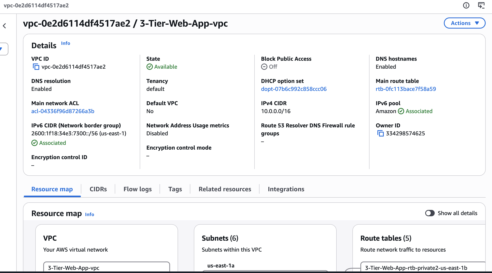
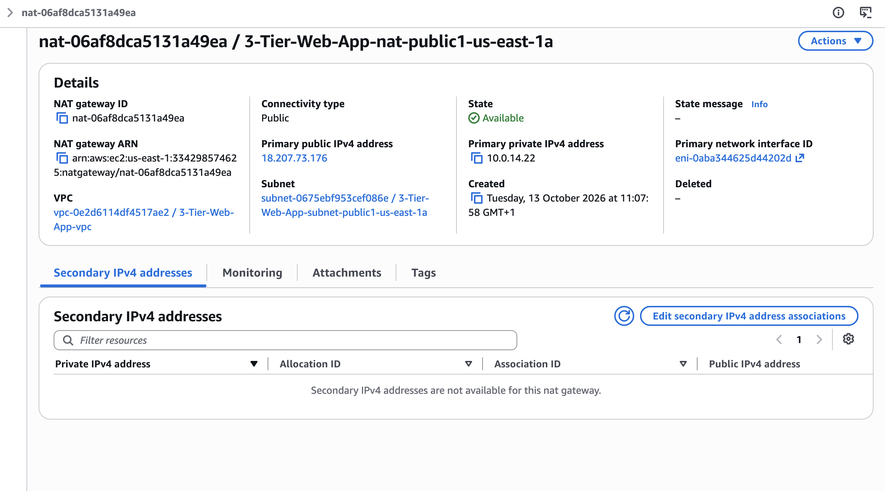
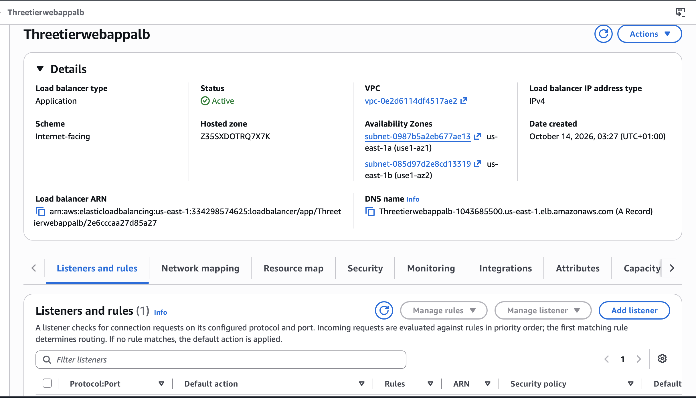
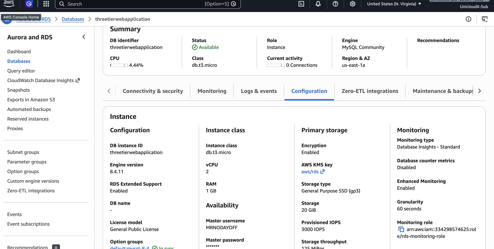
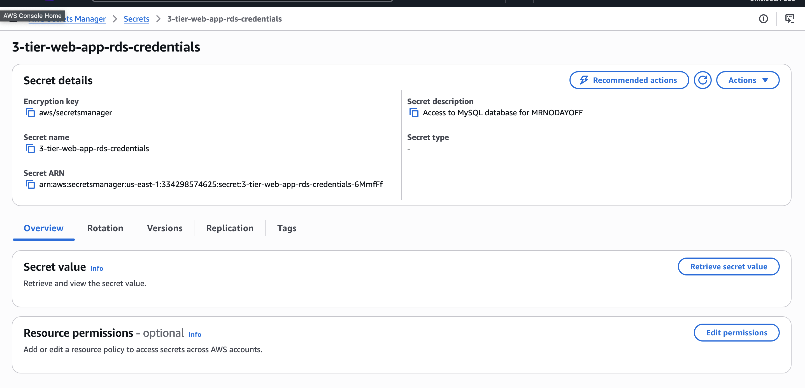
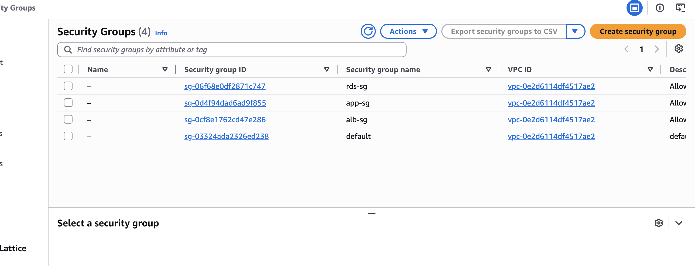
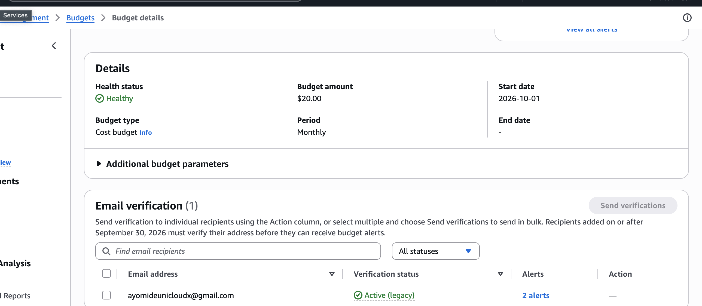
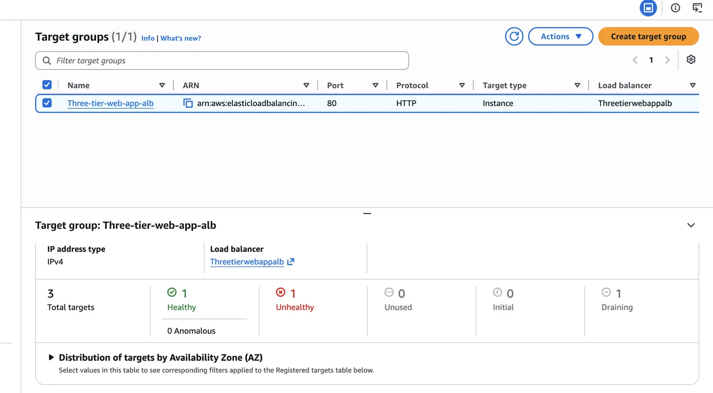
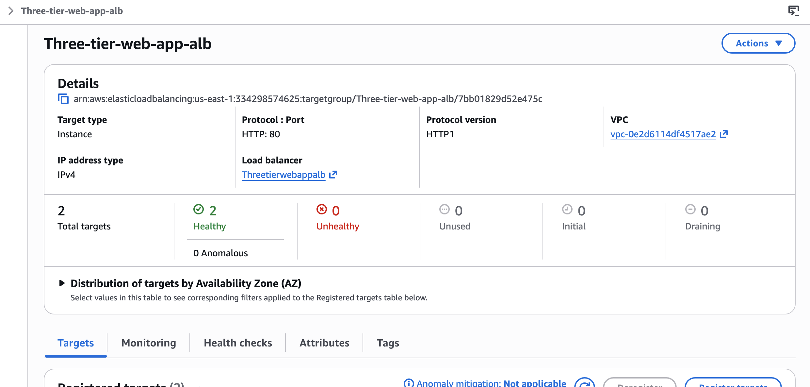
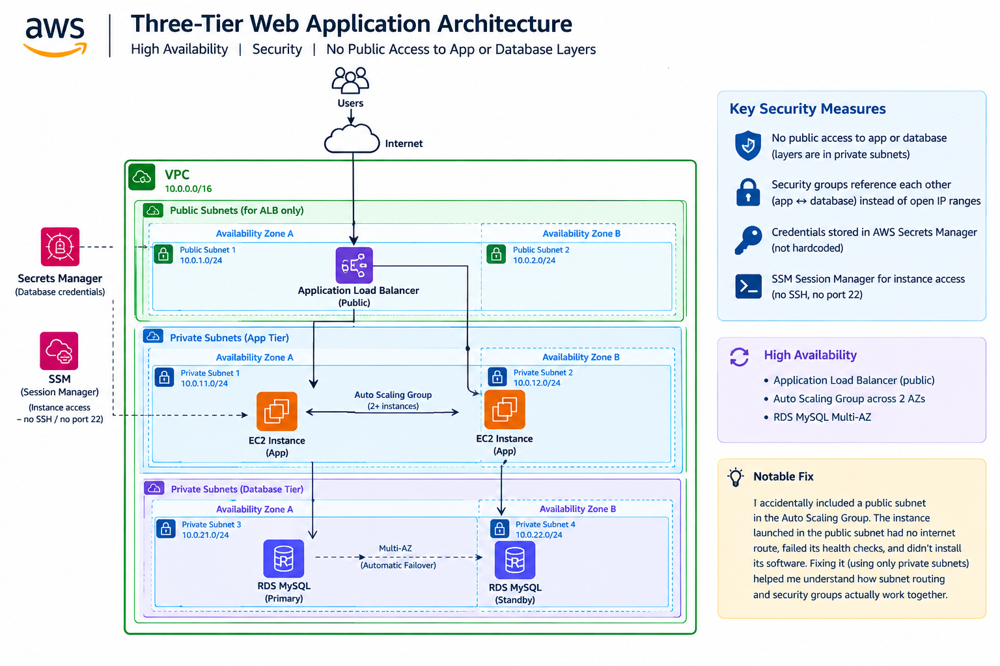

### AWS Three-Tier Web Application
A production style three-tier-web-architecture built on AWS, designed for high availability and strict network isolation: no single point of failure, and no direct internet exposure for the application or database layers.
Live test endpoint (via ALB): Threetierwebappalb-1043685500.us-east-1.elb.amazonaws.com
Architecture
                         Internet
                             │
                    ┌────────▼────────┐
                    │   alb-sg (80)   │   0.0.0.0/0 → 80/443
                    └────────┬────────┘
                    ┌────────▼────────┐
                    │  Application    │   Public subnets
                    │  Load Balancer  │   (us-east-1a / 1b)
                    └────────┬────────┘
                    ┌────────▼────────┐
                    │   app-sg (80)   │   from alb-sg only
                    └────────┬────────┘
                    ┌────────▼────────┐
                    │  EC2 Auto       │   Private app-tier subnets
                    │  Scaling Group  │   (us-east-1a / 1b)
                    │  SSM only,      │   No public IP, no SSH
                    │  no SSH         │
                    └────────┬────────┘
                    ┌────────▼────────┐
                    │   rds-sg (3306) │   from app-sg only
                    └────────┬────────┘
                    ┌────────▼────────┐
                    │  RDS MySQL      │   Private data-tier subnets
                    │  Multi-AZ       │   (us-east-1a primary /
                    │                 │    us-east-1b standby)
                    └─────────────────┘
Every arrow above is a security group reference, not an open CIDR range ; each tier can only be reached by the tier directly in front of it.
Services used
### Service	Role
VPC	Custom VPC across 2 AZs, with public, private app-tier, and private data-tier subnets

NAT Gateway	Single zonal NAT Gateway: gives the app tier outbound internet access (updates, SSM endpoints) without being reachable from it

Application Load Balancer	Public-facing entry point, routes only to healthy targets

EC2 Auto Scaling Group	Runs the app tier in private subnets across both AZs, db.t3.micro/t2.micro-class, no public IPs

AWS Systems Manager (Session Manager)	Instance access with no open SSH port — access is IAM-controlled and logged in CloudTrail
RDS MySQL (Multi-AZ)	db.t3.micro, primary in us-east-1a with a standby in us-east-1b, fully isolated in the data tier

Secrets Manager	Stores RDS credentials — nothing hardcoded, nothing in source control

Security Groups	Three groups (alb-sg → app-sg → rds-sg), each referencing the one before it

AWS Budgets	Cost alarm at $20/month with 50% and 80% thresholds, set up before provisioning anything

### Design decisions
No SSH anywhere. Every instance is accessed via SSM Session Manager — no open port 22, no key pairs to manage or leak, every session logged in CloudTrail.
Security groups reference each other, never open CIDRs, for anything internal. Only alb-sg accepts traffic from 0.0.0.0/0, and only on 80/443.
The data tier has no internet route at all — not even via NAT. RDS doesn't need outbound internet access, so its route table only has the local VPC route.
Secrets, not hardcoded credentials. The app tier's IAM role reads the DB password from Secrets Manager at runtime.

Single NAT Gateway, not one per AZ, to control cost on a portfolio project; documented below as a known production trade-off.
Known trade-offs (what I'd change for real production)
Single NAT Gateway — cheaper, but it's a single point of failure for outbound internet access from the app tier. A production setup would use one NAT Gateway per AZ.
SecretsManagerReadWrite on the EC2 role, broader than needed; it can read/write any secret in the account. Production should scope this to a single secret ARN via an inline policy.
No auto-scaling policies configured yet the ASG currently runs a fixed desired capacity (2) rather than scaling on CPU/request count. Target tracking scaling policies are a natural next step.
Troubleshooting log

Real issues hit and fixed during the build, kept here because the fixes taught me more about how VPC networking, security groups, and RDS actually interact than a straight build without bug would have.
Networking
The VPC console's VPC and more wizard only supports 2 subnet tiers (public + private) — it can't build a dedicated data tier. Built public + app-tier subnets via the wizard, then manually added the 2 data-tier subnets afterward.
The wizard's subnet CIDRs weren't sequential /24 as expected, it assigned non-sequential /20 blocks. Had to check the actual allocated ranges before picking free space for the manually-added data subnets.
A subnet's name and its actual Availability Zone can silently mismatch. A subnet named ...-us-east-1b was physically created in us-east-1a because the AZ dropdown wasn't double-checked at creation time. This wasn't caught until DB subnet group creation failed with an AZ-coverage error — had to delete and recreate the subnet with the AZ explicitly verified.
The data-tier route table intentionally has no 0.0.0.0/0 route at all (not even via NAT) — RDS doesn't need outbound internet access, so this is more secure than reusing the app-tier's NAT-routed table.
RDS
AWS resource names can't start with a digit ; a DB subnet group name starting with 3 was rejected; renamed to start with a letter.
The RDS "Production" template only offered m5/r5-family instances for Multi-AZ by default (estimated $254/month) — the smaller t3/t4g burstable classes were hidden behind a "Show filters" toggle on the instance class picker, defaulting to "Standard classes." Switching the filter to "Burstable classes" revealed db.t3.micro, dropping the estimate to $29/month.
"Public access" defaults to Yes in the RDS creation wizard — caught and changed to No before launch, since leaving it on would have given the database a public IP and defeated the entire point of the private data tier.
DB subnet group creation was missed during the initial build pass and only discovered at RDS launch time, when the subnet group dropdown had nothing to select.
Load balancer / Auto Scaling
Ended up with two separate ALBs + target groups after a first attempt via the ASG wizard appeared not to work, followed by manually creating a second one — both got attached to the same ASG. Resolved by identifying which one was actually serving traffic and deleting the duplicate (running two ALBs doubles the hourly cost).
Root cause of persistent "Request timed out" health checks: the ALB itself had app-sg attached instead of alb-sg. Since app-sg's only inbound rule allows traffic specifically from alb-sg, the ALB couldn't properly receive public traffic or reach the EC2 instances for health checks. Fixed by swapping the ALB's security group to alb-sg, restoring the intended chain.
The most significant bug: one EC2 instance kept failing health checks even after every security group was confirmed correct. Checking the instance's own Subnet ID revealed it had launched into a public subnet instead of the private app-tier subnet, the Auto Scaling Group's subnet configuration had a public subnet mixed in. With no public IP assigned, the instance had no usable internet route at all (a public subnet routes to the Internet Gateway, which requires a public IP to work — it does not fall back to the NAT Gateway), so its startup script silently failed to install the web server. Fixed by correcting the ASG's subnet configuration to use only the two private app-tier subnets, then terminating the misplaced instance so the ASG replaced it correctly.

Cost
Built and tested on a $20/month AWS Budgets alarm. Final running configuration (db.t3.micro Multi-AZ RDS, t2.micro EC2, single NAT Gateway, single ALB): ~$29–40/month if left running continuously. RDS and EC2 both bill hourly, so short-lived verification runs cost a small fraction of that.

http://threetierwebappalb-1043685500.us-east-1.elb.amazonaws.com/

Author - Ayomide Oladapo AWS Certified Cloud Practitioner ·

